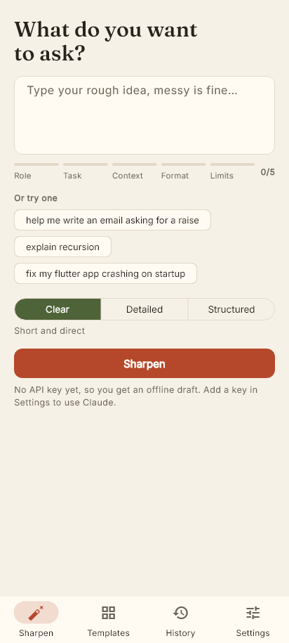
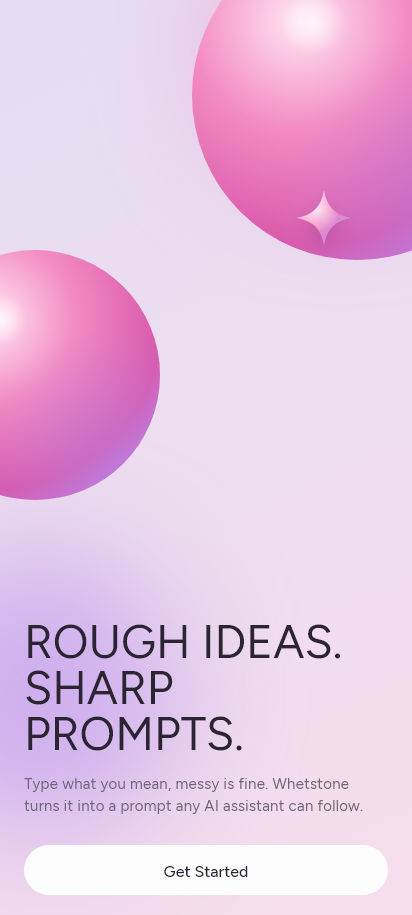
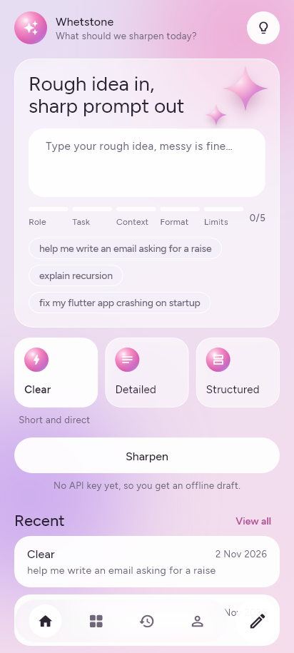
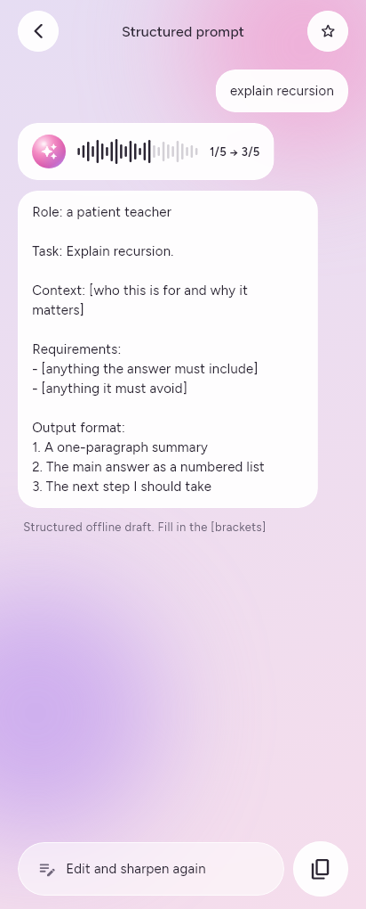
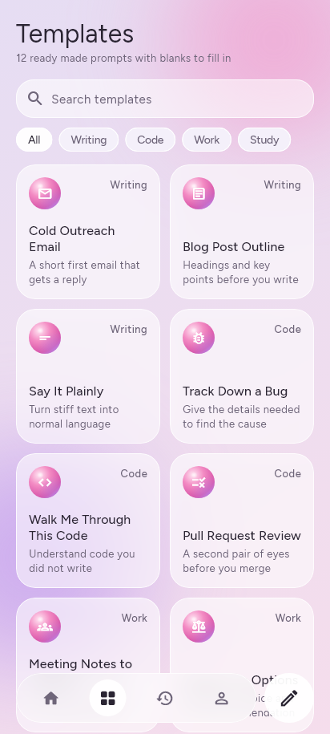
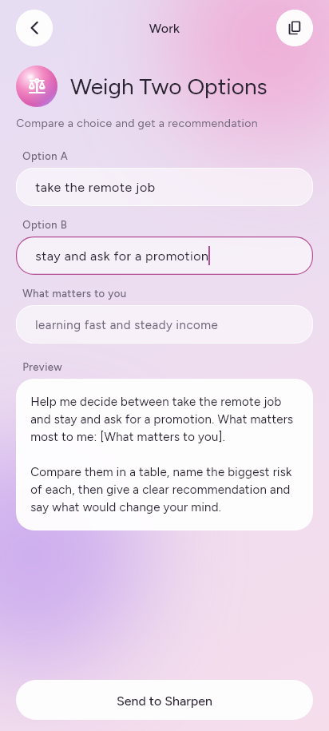
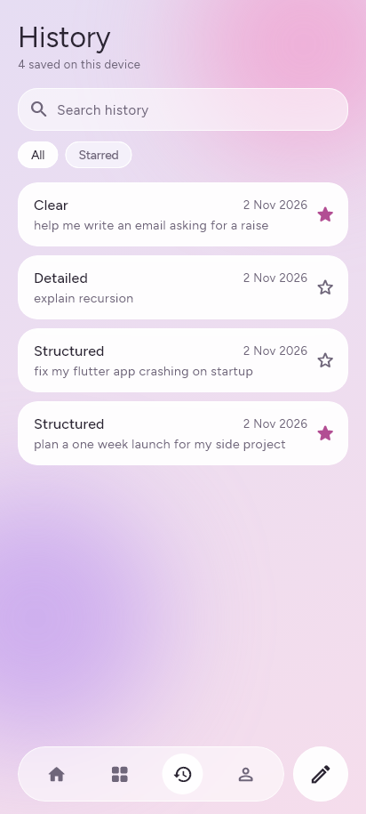
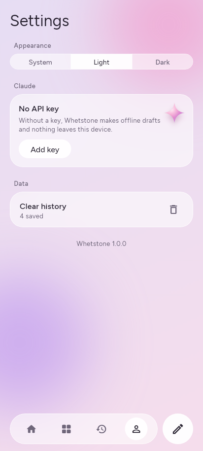
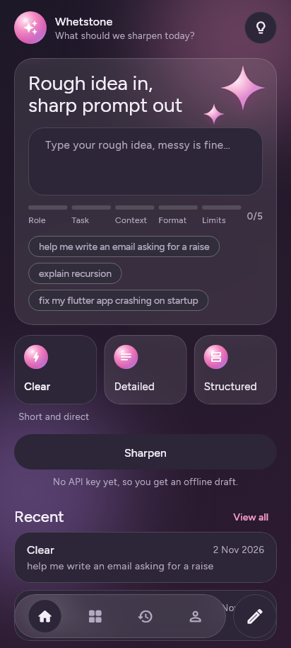
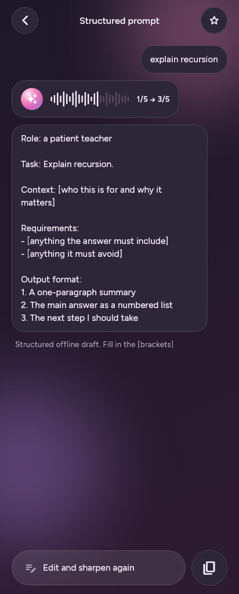

# Whetstone

**Turn a rough idea into a sharp prompt.** Whetstone is a Flutter app for Android and Windows. Type a messy request and it rewrites it into a clear prompt you can paste into any AI assistant. It also shows you which parts your prompt is missing.

<p align="center">
  
</p>

## Screenshots

| Welcome | Home | Result |
|:---:|:---:|:---:|
|  |  |  |
| **Templates** | **Template detail** | **History** |
|  |  |  |
| **Settings** | **Dark home** | **Dark result** |
|  |  |  |

## Design

The look is "frosted lilac". Every screen sits on a lavender to pink gradient with two blurred color blobs behind it. Cards are see-through white glass (a `BackdropFilter` blur with a white tint), buttons are white pills, and the tab bar floats at the bottom as a glass pill with a round "new prompt" button next to it. The glossy balls and sparkles are drawn in code with radial gradients and a `CustomPainter`, so there are no image assets. Text is set in Figtree.

Results open on their own screen as a short chat: your rough prompt on the right, the sharpened one on the left, and the before and after score drawn as a row of bars like a voice message.

## Features

- **Prompt rewriting with Claude.** Add your own API key and the rewrite streams in as it is generated.
- **Welcome screen** on the first launch, then straight to the home screen after that.
- **Three focus modes**, picked from tiles on the home screen. Clear is short and direct, Detailed spells out depth and examples, and Structured uses labelled sections.
- **Offline drafts.** With no key, the app wraps your prompt in a good structure and leaves `[brackets]` for you to fill in. If a Claude request fails, you can switch to a draft from the error message.
- **Sharpness meter.** A live check for the five parts of a good prompt: role, task, context, format and limits.
- **12 templates** across Writing, Code, Work and Study, with search, category filters and a live preview.
- **History.** Every result is saved on the device, and you can search it, star items, swipe to delete, or tap to reopen one. The two newest also show on the home screen.
- **Prompt tips.** The light bulb on the home screen explains the five parts the meter looks for.
- **Light, dark and system themes.**

## How it works

1. `SharpenProvider` reads the input and checks whether there is an API key.
2. With a key, `ClaudeService` sends a streaming request to the Claude Messages API. Dart has no official SDK, so this is a plain `http` request, and the response is read line by line as server-sent events.
3. Without a key, `LocalSharpener` picks a role from keywords in the prompt and fills a fixed structure for the chosen focus.
4. The finished result goes to `HistoryProvider`, which saves it as JSON in `shared_preferences`.

The meter is `PromptChecker`, a set of keyword patterns. It is a quick hint and doesn't understand the prompt, so a high score doesn't guarantee a good prompt. Unfilled `[brackets]` don't count towards the score.

## Privacy

Without an API key, nothing leaves the device. With a key, your prompt is sent to the Claude API and usage is billed to your Anthropic account. The key is kept in `flutter_secure_storage` rather than `shared_preferences`, and it is only sent to `api.anthropic.com`.

## Tech stack

| | |
|---|---|
| Framework | Flutter 3.38, Dart |
| State | Provider |
| Network | http, with streaming |
| Storage | shared_preferences, flutter_secure_storage |
| Model | Claude Opus 5.5 (`claude-opus-5-5`) |

## Getting started

```bash
git clone https://github.com/sirine2907/-Whetstone.git
cd -- -Whetstone
flutter pub get
flutter run
```

The app works straight away with offline drafts. To use Claude, create an API key at [console.anthropic.com](https://console.anthropic.com) and paste it into **Settings**.

## Project structure

```
lib/
  data/        the template list
  models/      SharpenedPrompt, PromptTemplate
  providers/   nav, settings, history and sharpen state
  screens/     one file per screen, including welcome and result
  services/    ClaudeService, LocalSharpener, PromptChecker
  widgets/     glass card, background, glossy shapes, prompt tile, meter
  theme.dart   colors and the light and dark themes
```

## Tests

```bash
flutter test test/prompt_checker_test.dart test/claude_service_test.dart test/app_test.dart
```

The API tests use a fake HTTP client, so they make no network calls and need no key.

The screenshots above come from golden tests that render each screen. To update them:

```bash
flutter test test/screenshots --update-goldens
```

The demo GIF is recorded the same way, then the frames are joined with Pillow:

```bash
flutter test test/screenshots/demo_test.dart --update-goldens
python tool/make_demo_gif.py
```

The demo runs in offline mode, so it shows offline drafts rather than Claude rewrites.

## License

MIT, see [LICENSE](LICENSE). The bundled Figtree font is under the SIL Open Font License, included in [assets/fonts](assets/fonts).
